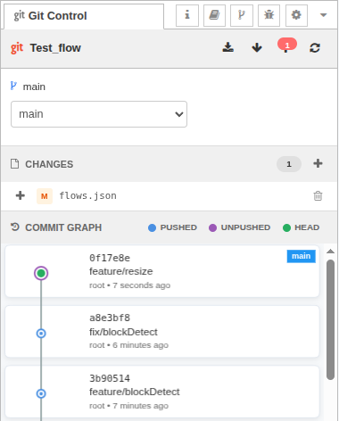

# Git Control for Node-RED

`@rosepetal/node-red-contrib-git-control` provides a sidebar plugin for Git version control of the active Node-RED project (commits, branches, merges and synchronization with a remote from the editor, with diff, revert and merge-conflict resolution per flow and per node) and the HTTP admin API behind it.

## Installation

```bash
cd ~/.node-red
npm install @rosepetal/node-red-contrib-git-control
```

Or search `@rosepetal/node-red-contrib-git-control` in the Node-RED Palette Manager.

Restart Node-RED after an `npm install`. The **Git Control** tab is then in the sidebar of the editor, next to Debug and the other tabs.

## Requirements

- Node.js >= 18
- Node-RED >= 2.0.0
- Node-RED projects enabled (`editorTheme.projects.enabled: true` in `settings.js`) and an active project. The plugin works on the Git repository of the active project; with projects disabled the tab is not added
- `git` available to the Node-RED process
- An SSH key among Node-RED's project keys *(optional, for a remote over SSH)*

## Reference

| Page | Contents |
|------|----------|
| **[HTTP API](./http-api.md)** | The admin endpoints under `/rosepetal-git`: authentication, permissions, and the request and response of every operation |

## What It Does

- **Flow-aware diff and revert**: changes are listed per flow tab, subflow and node instead of as lines of `flows.json`. One flow or one node can be reverted without touching the rest of the file.
- **Flow-aware merge resolver**: when a merge conflicts on the flow file, the plugin merges it node by node and asks only about the nodes that both sides changed. Take ours or theirs for everything, for a flow, or for a single node.
- **Commit graph**: the history with branch labels, push status and parent relationships, and per commit the flows and files it changed.
- **Detached HEAD safety**: a commit made from an old commit is put on a new branch, so it is not orphaned.
- **Flow synchronization**: after a checkout, reset, revert, merge or pull the flows are reloaded from disk, so the editor and the runtime match the repository.
- **Conflict banner**: while a merge, cherry-pick, revert or rebase is in progress, a banner lists the conflicted files and offers **Abort** and, for a merge, **Resolve**.
- **Error messages with a suggestion**: a rejected push, a missing identity, an authentication failure and similar errors are reported with the next step to take.
- **Node-RED's own project and keys**: the plugin uses the active project, the Git identity of the Node-RED user and the project SSH keys.



## Quick Start

1. Open the **Git Control** tab in the sidebar. Its header shows the name of the active project.
2. Edit a flow and deploy. The changed files appear under **Changes**, and under the flow file, the flows that changed.
3. Type a message under **Create Commit** and click **Commit**. Every change is committed; there is no staging step.
4. Click **Push** in the toolbar. The first push of a branch creates the branch on the remote and sets it as upstream.

## The Sidebar Tab

### Toolbar

| Button | Action |
|--------|--------|
| **Fetch** | Download the commits of the remote without merging them (`git fetch --prune`) |
| **Pull** | Fetch and fast-forward. When the branch and its upstream have diverged, ask before creating a merge commit |
| **Push** | Push the current branch to its upstream. A branch without upstream is published to the remote and linked to it. When the push is rejected because the remote has newer commits, a dialog offers **Pull**, **Force push** (`--force-with-lease`, with a second confirmation) or **Cancel** |
| **Refresh** | Reload every panel from the repository |

The numbers on **Pull** and **Push** are the commits the branch is behind and ahead of its upstream.

### Branches

The first row is the branch picker. It lists the local branches and the branches that exist only on `origin`; picking one checks it out. Typing a name that does not exist creates that branch from the current one.

The menu next to it has the other branch actions:

| Action | Result |
|--------|--------|
| **New branch from current** | Create a branch and check it out; uncommitted changes come along |
| **Merge branch into current** | Merge a local branch into the current one |
| **Rename current branch** | Rename it and realign its upstream: `origin/<new name>` if it exists, otherwise none |
| **Delete a branch** | Delete a local branch other than the current one. A branch with unmerged commits needs a second confirmation |
| **New orphan branch** | Start a branch with no history; the current files are kept, to be committed as its first commit |

The second row is the upstream picker: the remote branch that the current branch tracks. Picking another remote branch sets it as upstream. Typing a name that is not on the remote pushes the current branch there, after a confirmation, and sets it as upstream.

### Changes and Commit

**Changes** is a single list of every modified, created or deleted file. The trash icon of a file discards its changes, which cannot be undone.

Under the flow file the list shows the units that changed since the last commit. A unit is a flow tab, a subflow, or the group of global configuration nodes. Click a unit to see its added, removed and modified nodes with their fields before and after. The unit, or a single node inside it, can be reverted to the last commit.

**Create Commit** appears when there are changes. **Commit** stages everything and commits it.

### Commit Graph

The graph shows the last 50 commits with their hash, message, author, age and branch labels.

| Mark | Meaning |
|------|---------|
| Blue dot | The commit is on the upstream branch |
| Purple dot | The commit is not pushed |
| Green ring | The current `HEAD` |

Click a commit to expand its details: the full hash, the branches that contain it, the flows and the files it changed compared with its parent, and these actions:

| Action | Result |
|--------|--------|
| **Checkout** | Check out the commit (detached HEAD). Refused while there are uncommitted changes |
| **Branch here** | Create a branch at the commit and check it out |
| **Reset here** | Move the branch to the commit; the files stay as uncommitted changes |
| **Revert** | Create a new commit that undoes the commit |
| **Reset --hard** | Move the branch to the commit and discard the later commits and all uncommitted changes |

In **Changed flows**, click a unit to see what the commit changed in it. The restore button brings the unit, or a single node, back to its version in that commit as an uncommitted change. In **Changed files**, click a file to see its text diff.

### Merge Conflicts

A merge or a pull that hits a conflict leaves the repository in the middle of the operation. The banner shows the conflicted files and an **Abort** button, which returns the repository to the state before the operation.

When the operation is a merge and the flow file is the only conflicted file, the banner also has a **Resolve** button. The resolver shows the nodes that both sides changed, grouped by unit, with the fields of each side:

- **Take ours for all** / **Take theirs for all**: one side for every conflict. It overrides the choices below.
- **Take ours** / **Take theirs** on a unit: one side for the whole flow, subflow or configuration group.
- **ours** / **theirs** on a node: one side for that node. It overrides the choice of its unit. Where one side deleted the node, its button reads **drop**.

"Ours" is the current branch and "theirs" the branch being merged. Changes that only one side made are merged without asking. **Resolve & commit** writes the merged flow file and creates the merge commit with the message in the editor, which starts as the message Git prepared.

Conflicts in other files, and conflicts of a cherry-pick, revert or rebase, are resolved outside the plugin.

### Detached HEAD

After checking out a commit, a banner warns that `HEAD` is detached. **Return to Latest** checks out the branch you were on. A commit made in this state goes to a new branch named `from-` plus the first seven characters of the new commit's hash; the plugin asks before creating it.

## Git Identity and SSH Keys

Commits are authored with the Git name and email of the Node-RED user settings. A field that is not set there is read from the Git configuration (`user.name`, `user.email`).

For a remote over SSH the plugin uses one of the keys that Node-RED keeps for projects in `<userDir>/projects/.sshkeys`. The key is chosen per project: the one selected through the HTTP API, else a key named after the project, else the only key present. SSH then runs with that key only and ignores `~/.ssh/config`. When no key applies, Git connects with its default SSH settings.

## HTTP API

The sidebar works through HTTP admin endpoints under `/rosepetal-git`. Scripts and external tools can call them too, and they cover some operations that the sidebar does not have, such as staging individual files, cherry-pick and SSH key selection.

| Category | Endpoints |
|----------|-----------|
| **Project and status** | `project-info`, `status`, `log`, `branches`, `commit-branches` |
| **Working tree** | `add`, `unstage`, `commit`, `discard`, `discard-all`, `reset` |
| **Branches** | `checkout`, `validate-checkout`, `create-branch`, `orphan-branch`, `delete-branch`, `rename-branch`, `set-upstream` |
| **Remote** | `fetch`, `pull`, `push`, `force-push` |
| **History** | `merge`, `revert`, `cherry-pick`, `abort` |
| **Conflict resolver** | `merge/preview`, `merge/resolve` |
| **Diff** | `file-diff`, `commit-diff`, `flow-diff`, `flow-units` |
| **Flow-aware revert** | `revert-flow-unit`, `revert-flow-nodes` |
| **SSH keys** | `ssh-keys`, `ssh-key` |

When Node-RED admin authentication is enabled, the endpoints require the `git-control.read` or `git-control.write` permission. See the [HTTP API](./http-api.md) reference.

## License

Apache-2.0.

The package is published on npm as [`@rosepetal/node-red-contrib-git-control`](https://www.npmjs.com/package/@rosepetal/node-red-contrib-git-control).
